<!-- Repo name must be exactly your username: mahfujur-at (Public, branch: main) -->

---

## 🪪 ~/bio-data

| | |
|:--|:--|
| 👤 **Name** | MD. MAHFUJUR RAHMAN |
| 💼 **Profession** | IT Support & Technician |
| ⏳ **Experience** | 4+ years (2022 – present), self-employed |
| 🌍 **Country** | Bangladesh |
| 🎯 **Looking for** | Entry-level IT Support / Helpdesk role in Austria |
| ✅ **Availability** | Ready to start immediately · Willing to relocate |
| 🛠️ **Track record** | 300+ happy clients · 300+ computers fixed |
| 📧 **Email** | [mahfujur.at@gmail.com](mailto:mahfujur.at@gmail.com) |
| 🌐 **Portfolio** | [mahfujur.at](https://mahfujur.at) |

---

## 🖥️ ~/about

I'm **MD. Mahfujur Rahman**, an IT Support Technician with **4+ years** of hands-on experience helping home users and small businesses.

Since 2022 I have worked as a self-employed technician: I've fixed **300+ computers**, installed Windows 10/11 and MS Office 365, upgraded hardware, set up LAN/Wi-Fi networks, and built websites with WordPress, Elementor and WooCommerce. I give fast remote support with **TeamViewer & AnyDesk** and document every problem so it doesn't happen again.

- 🔧 **Hardware & troubleshooting:** PC/laptop repair, upgrades, won't-start faults
- 💿 **Windows & Linux:** installation, setup, software
- 🛡️ **Virus & security:** cleanup and protection basics
- 🌐 **Network:** LAN/WAN, Wi-Fi, router setup
- 🖨️ **Printer, scanner & CCTV** setup
- 🧩 **WordPress, Elementor & WooCommerce** websites, shop and speed optimization
- ⭐ **Core skills (self-rated "Ausgezeichnet" / Excellent):** Computer Hardware, Networking, Windows 11, MS Office 365, WordPress & Elementor, Hardware/Software Troubleshooting

> 💬 *My promise: I don't just fix your PC, I give you peace of mind.*

### 💼 Experience

| Period | Role | What I do |
|:--|:--|:--|
| 2022 – present | **IT Support & Technician** (self-employed) | Helpdesk & IT support, Windows 10/11 and networking, hardware troubleshooting, remote support |
| 2026 – present | **WordPress & Elementor** | Building business, blog, portfolio and WooCommerce websites |

### 🎓 Education

| Period | Qualification | Institution |
|:--|:--|:--|
| Aug 2023 – present | **Higher Secondary Certificate (HSC)**, Science | Kazipur Govt. Mansur Ali College |
| Jan 2021 – Jul 2023 | **Secondary School Certificate (SSC)**, Science | Sabuj Kanan High School |

---

## ⚙️ ~/skills

  

---

## 📌 ~/projects

<!-- More pinned cards: copy the block above and change repo=YOUR_REPO_NAME -->

🌐 **Live portfolio:** [mahfujur.at](https://mahfujur.at)

---

## 📊 ~/stats

 

---

## 📫 ~/contact

  

